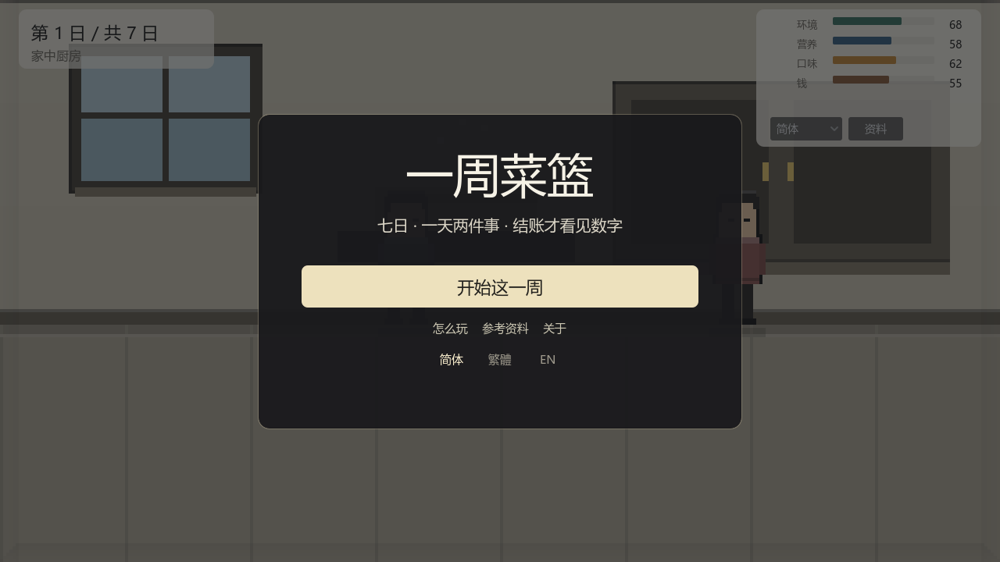
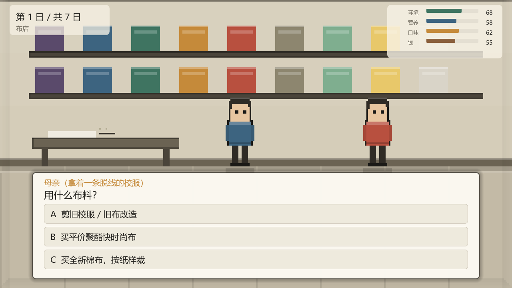
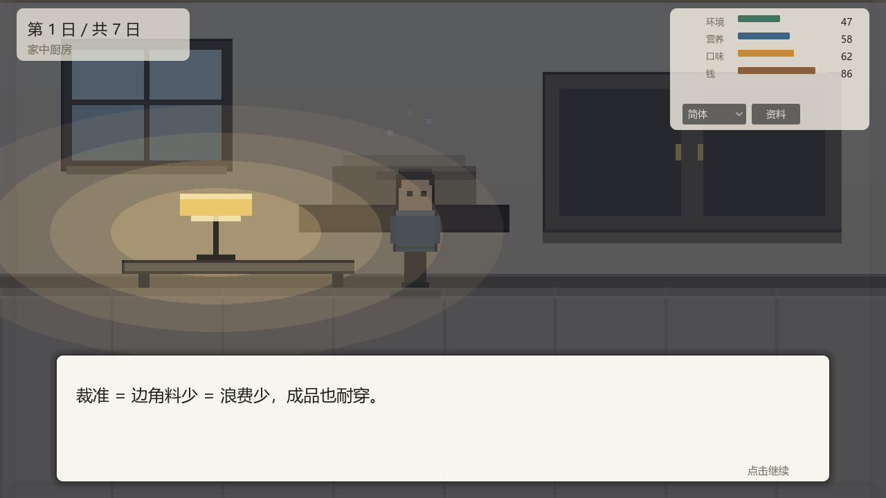

# 一周菜篮 · One-Week Basket

**香港家政 / 科技与生活课堂用的七日情景模拟器。**
NPC 派任务 → 连续几步「不带数字」的选择 → 结算日才结账，逐笔告诉你代价落在哪里。

七天、每天两件事；另有配套的三分钟轻考核、一个可选的现场答题小后端，以及一份 Godot 像素版。



---

## 下载即玩

到 [**Releases**](https://github.com/Ja-Treffer/Food-basket-in-a-week/releases/latest) 取：

| 文件 | 用法 | 体积 |
|---|---|---|
| `One-Week-Basket.exe` | Windows 单文件，双击即玩（pck 已内嵌） | 46 MB |
| `one-week-basket-web.zip` | 解压丢到任意静态站；**必须走 http(s)**，双击 `index.html` 打不开 | 10 MB |

校验（`sha256`）：

```
One-Week-Basket.exe       54782db94ac940be36096b57fdaa520dcb66a09e7b201b3529c9e1d0fbe7582d
one-week-basket-web.zip   096fa7e69ca1a92bc9682e488de17c7f154edace786e4ce456432e057f74a4fe
```

仓库里**没有**编译产物 —— `dist/` 与 `godot/build/` 都被 `.gitignore` 挡着，发布只走 Release。

## 浏览器里直接开

| 想做什么 | 怎么做 |
|---|---|
| 玩模拟器 | 双击 `game.html`（或 `game.html?seed=2026&lang=tw`） |
| 做轻考核 | 双击 `review.html`，6 题 3 分钟 |
| 全班同一套题 | `review.html?seed=2026` |
| 现场答题 | `node live/server.mjs 8788` → 主持 `http://localhost:8788/`，学生 `http://<内网IP>:8788/play` |

`game.html` 与 `review.html` 零依赖、零联网，`file://` 下功能完整（含 `?lang=`）。只有 `live/` 需要 Node 起服务。

## 它长什么样

| 出题 | 结账 |
|---|---|
|  |  |

- **没有数字**：选的时候看不到任何读数、区间、推荐或禁用。
- **没有分数**：结算只把四条账（环境负荷 / 营养均衡 / 口味接受度 / 可用钱）摊开，逐笔解释。
- **没有全赢**：四条账互相拉扯，多数题不存在四头都赚的一手。
- **有依据**：每一笔都挂编号（H1 / R5 / F1…），右上「资料」可翻原文摘录。

## 三语

简体 / 繁體 / English，标题页先选语言，进游戏后右上角还能换。
文案集中在 `data/game-i18n.json`（594 条 `{zh,tw,en}`），浏览器版、现场答题、Godot 版共用同一份。

## 结构

```
tradeoff-sim/
├─ game.html                 模拟器（生成物，双击即开）
├─ review.html               轻考核（单文件，可打印）
├─ src/game.template.html    模拟器真源 —— 手改这一份
├─ data/                     三语词典 + 题库导出
├─ tools/                    生成、校验、打包脚本（node / pwsh，零依赖）
├─ live/                     现场答题：后端 + 主持端 + 学生端
├─ godot/                    Godot 4.7.2 像素版（MVP 分层）
├─ docs/                     九份文档
└─ dist/                     编译产物（不进仓库）
```

主要命令：

```bash
node tools/patch_game_i18n.cjs    # 改完模板 → 重新生成 game.html
node tools/sync_godot_data.cjs    # 模板 → Godot 的数据
node tools/check_review.cjs       # 题库自检（三语、长度、抽样）
pwsh -File tools/package.ps1      # 或 powershell -File，导出 exe + web 收进 dist/
```

## 文档

从 [`docs/README.md`](docs/README.md) 进：概览、架构、数据模型、构建、i18n、决策记录（ADR）、术语表、来源、机制。

## 边界

四条读数是**教学映射**，不是排放因子、营养素含量或港币；方向取自参考资料，刻度由课程目标决定。
不评分、不排名、不算碳足迹。食材按香港现实写 —— 几乎没有本地农业，菜基本靠外来。

## 许可证

代码 [MIT](LICENSE)。引用的参考资料（卫生防护中心、渔护署、IPCC 等）版权归原作者，本项目只作摘录引用。
